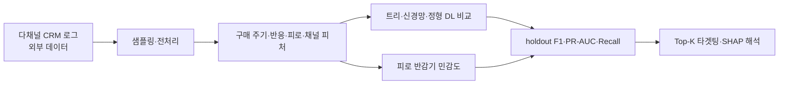

# 동태적 마케팅 지식 기반 구매 전환 예측

[English](README.md) · [사례 연구](PORTFOLIO.ko.md)

이커머스 CRM 메시지를 받은 고객 중 누가 구매할지를 예측합니다. 구매 주기·반응 시점·메시지 피로도·채널 적합도처럼 마케팅 이론에서 가져온 피처를 REES46 메시지 로그 약 1억 7,200만 건에 적용했고, holdout에서 구매로 이어진 비율은 0.1234%에 불과합니다.

**왜 중요한가.** 모든 캠페인을 모든 고객에게 보내면 비용이 들고 고객도 지칩니다. 그래서 필요한 결과물은 누구에게 연락할 가치가 있는지에 대한 순위입니다. 이 전환율에서는 정확도가 의미가 없고, 모델이 구매자를 얼마나 찾아내며 그 과정에서 메시지를 얼마나 낭비하는지가 관건입니다.

**결과(원고 보고 기준).** 원분포 holdout에서 XGBoost에 도메인 피처를 더하자 F1은 0.3550에서 0.3806으로, PR-AUC는 0.3177에서 0.3620으로 올랐습니다. Recall은 30.74%에서 52.30%로 높아졌지만 precision은 0.4199에서 0.2991로 낮아졌습니다. 즉 구매자를 더 많이 찾는 대신 헛된 접촉도 늘었습니다. 점수 상위 0.78%만 고르면 holdout 전환의 95.83%를 포착했는데, 이는 오프라인 모의 선별 결과이며 실제 비용 절감이나 인과적 증분 효과가 아닙니다.

원고는 심사 중이라 포함하지 않았고 원본 로그도 재배포하지 않습니다. 저장소에 보관된 더 작은 XGBoost 실행 결과는 데이터 없이 확인할 수 있습니다([실행](#실행) 참고).

## 연구 질문과 데이터

희소한 구매 전환 클래스에서 도메인 지식 기반 동태 피처가 전환 예측과 타겟팅 판단을 개선하는지 살핍니다. 피처는 구매·재구매 주기, 시계열 반응, 마케팅 피로도, 채널 효과성의 네 묶음입니다.

- 데이터: Kaggle REES46 *E-commerce multichannel direct messaging 2021–2023*, 약 2년의 다채널 이커머스 CRM 로그
- 규모(원고 기준): 메시지 이벤트 약 1억 7,200만 건, 고객 약 185만 명, 캠페인 1,907개
- 타깃: 구매 전환, 원분포 holdout 전환율 0.1234%
- 비교: ML·신경망·정형 DL 9개 모델, F1·PR-AUC·재현율·타겟팅 분석

## 분석 흐름



원본 CRM 로그는 포함하지 않습니다. 실행 코드와 요약 결과가 이 흐름의 근거를 남깁니다.

## 핵심 결과

원고 보고 기준, 원분포 holdout에서의 XGBoost 결과입니다.

| 지표 | 베이스라인 피처 | 도메인 피처 포함 |
|---|---:|---:|
| Precision | 0.4199 | 0.2991 |
| Recall | 30.74% | 52.30% |
| F1 | 0.3550 | 0.3806 |
| F2 | 0.3248 | 0.4549 |
| PR-AUC | 0.3177 | 0.3620 |

- 상대 Recall 개선: 70.1%
- 점수 상위 0.78% 타겟팅: 전환 95.83% 포착, 전체 후보에 보내는 경우보다 발송 대상 99.22% 감소

저장소에 보관된 결과(`final_data_100k_64.parquet`, 64개 피처, holdout 1,499,900행을 쓴 별도의 작은 실행):

| 지표 | 도메인 피처 포함 XGBoost |
|---|---:|
| F1 | 0.3833 |
| PR-AUC | 0.3534 |
| 근거 | `research/predict/result_xgb.json` |

두 결과는 데이터 규모와 분할이 달라 합치지 않습니다. 피로 반감기 배수를 0.50x~1.50x로 바꾼 보관 실험에서 PR-AUC는 0.3527~0.3613 범위에 머물렀습니다(`research/predict/tau_sweep_results/`).

## 결과가 뜻하는 것과 뜻하지 않는 것

- 한 플랫폼의 관찰 데이터와 무작위 holdout에서 나온 연구 결과이며, 일반적인 인과 효과 추정이 아닙니다.
- Top-K 수치는 holdout에서의 모의 선별입니다. 실제 발송 기록·단가·대조군이 없으므로 실제 비용 절감이나 증분 전환이 아닙니다.
- Recall이 오르는 동안 precision은 떨어졌습니다. 운영 기준점을 정하려면 접촉 비용과 놓친 구매자의 비용이 필요한데, 이 자료는 없습니다.
- 원고는 단일 플랫폼 일반화, 고정된 피로 반감기 파라미터, 인과추론 부재, 계산 효율 미측정을 한계로 밝힙니다.
- SHAP 결과는 연관성이며 인과적 증분 효과의 근거가 아닙니다.

## 연구 그림


*그림 1. 네 개의 CRM 입력 테이블, 베이스라인과 네 가지 도메인 피처 묶음, 9개 모델, 원고의 평가 패널(모델 비교, 피처 묶음 ablation, Top-K 타겟팅, 반감기 민감도, SHAP)로 이어지는 연구 흐름입니다. 패널의 수치는 위 표의 원고 보고 값과 같습니다.*


*그림 2. 양·음의 SHAP 기여 순으로 피처를 정렬하고, 각 피처가 속한 지식 범주(베이스라인, 피로도, 시계열 반응, 채널 효과성, 구매 주기)로 색을 구분했습니다.*


*그림 3. 문서화된 모델 실행에서 피처별 SHAP 값의 방향과 상대적 기여를 요약합니다. 연관성일 뿐 인과적 증분 효과의 근거는 아닙니다.*

## 실행

원본 데이터·학습된 모델·lockfile·원래 실행 환경이 없어 현재 체크아웃만으로 end-to-end 실행은 할 수 없습니다.

데이터 없이 보관 결과 확인(표준 라이브러리만 사용):

```powershell
python research\verify_baseline.py
```

`research/predict/result_xgb.json`이 저장된 지표 계약(F1, PR-AUC, recall, precision, Top-K hits)과 일치하는지 확인합니다. 모델을 다시 학습하는 것이 아니라 결과 보고서 회귀 검사입니다.

원본 Parquet가 있다면 경로를 직접 지정해 XGBoost를 다시 실행합니다.

```powershell
pip install -r requirements.txt
$env:MFA_DATASET_PATH = 'D:\path\to\final_data_100k_64.parquet'
$env:MFA_RESULTS_DIR = 'D:\path\to\new-results'
python research\xgb.py
python research\verify_baseline.py --result "$env:MFA_RESULTS_DIR\result_xgb.json"
```

그 밖의 진입점은 `research/preprocessing_fast.py`(피처 생성)와 `research/run_xgb_tau_sweep.py`(반감기 민감도)입니다. `requirements.txt`는 import에서 뽑은 목록이며 원래 버전이 기록되지 않아 수치가 정확히 일치한다고 보장할 수 없습니다. 자세한 내용은 [`research/RUN_MANIFEST.md`](research/RUN_MANIFEST.md)에 있습니다.

## 문서

- [포트폴리오 사례 연구](PORTFOLIO.ko.md)
- [저장소 리뷰](docs/PROJECT_REVIEW.md)
- [학술 요약](docs/ACADEMIC_SUMMARY.md)
- [CV 문구](docs/CV_BULLETS.md)
- [실행 매니페스트](research/RUN_MANIFEST.md)
