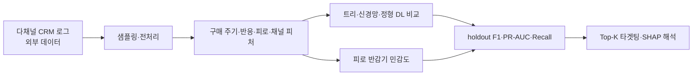

# 동태적 마케팅 지식 기반 구매 전환 예측

[English](README.md) · [사례 연구](PORTFOLIO.ko.md)

*동태적 마케팅 지식 통합을 통한 이커머스 구매 전환 예측 프레임워크: 데이터 중심 AI 접근법* — 제1저자 논문(교신저자 김경원), 『마케팅연구』(한국마케팅학회) 2026년 11월 게재 예정.

이커머스 CRM 메시지를 받은 고객 중 누가 구매할지 예측합니다. 구매 주기·반응 시점·메시지 피로도·채널 적합도처럼 마케팅 이론에서 가져온 피처를 REES46 메시지 로그 약 1억 7,200만 건에 적용했습니다. holdout 전환율은 0.1234%입니다.

**왜 중요한가.** 이 전환율에서는 정확도가 의미가 없습니다. 순위가 구매자를 얼마나 찾아내고 메시지를 얼마나 낭비하는지가 관건입니다.

**결과(원고, 원분포 holdout).** 도메인 피처를 더하자 XGBoost의 PR-AUC가 0.3177에서 0.3620으로, recall이 0.3074에서 0.5230으로 올랐고 precision은 0.4199에서 0.2991로 낮아졌습니다. 점수 상위 0.78%에만 연락하면 전환의 95.83%를 포착하며 이때 precision은 15.26%, 무작위 발송 대비 lift는 123.7배입니다. 상위 1만 건만 고르면 precision은 53.20%(431.1배)입니다.

## 연구 질문

양성 클래스가 희소할 때 도메인 지식 기반 동태 피처가 전환 예측과 타겟팅을 개선하는가? 피처는 네 묶음입니다.

1. 구매·재구매 주기
2. 시계열 반응
3. 마케팅 피로도(채널별 감쇠합, 반감기 24/48/72시간)
4. 채널 효과성

## 데이터와 평가

- **데이터:** Kaggle REES46 *E-commerce multichannel direct messaging 2021–2023*. 메시지 약 1억 7,200만 건, 고객 약 185만 명, 캠페인 1,907개(원고 기준)
- **타깃:** 구매 전환, holdout 전환율 0.1234%
- **모델:** 트리·신경망·정형 DL 9개
- **평가:** 원분포 holdout, F1·PR-AUC·recall·Top-K 타겟팅



## 결과

원고 보고 기준 XGBoost, 원분포 holdout:

| 지표 | 기본 피처 | 도메인 피처 추가 |
|---|---:|---:|
| Precision | 0.4199 | 0.2991 |
| Recall | 0.3074 | 0.5230 |
| F1 | 0.3550 | 0.3806 |
| F2 | 0.3248 | 0.4549 |
| PR-AUC | 0.3177 | 0.3620 |

**Top-K 타겟팅(원고, 테스트 메시지 25,798,280건):**

| 상위 K | 비율 | Precision@K | Recall | Lift |
|---|---:|---:|---:|---:|
| 10,000 | 0.04% | 53.20% | 16.71% | 431.1배 |
| 50,000 | 0.19% | 31.16% | 48.94% | 252.5배 |
| 200,000 | 0.78% | 15.26% | 95.83% | 123.7배 |

**저장소에 보관된 실행**(소규모 표본 `final_data_100k_64.parquet`, 피처 64개, holdout 1,499,900행, `research/predict/result_xgb.json`): F1 0.3833, PR-AUC 0.3534. 원고와 데이터 규모·분할이 달라 따로 제시합니다. 피로 반감기 배수 0.50x–1.50x 범위에서 PR-AUC는 0.3527–0.3613을 유지합니다(`research/predict/tau_sweep_results/`).

## 그림


*그림 1. 연구 흐름: CRM 테이블 4개, 기본·도메인 피처 4묶음, 모델 9개, 원고의 평가 패널.*


*그림 2. SHAP 기여도 순 피처 순위(색은 지식 범주).*


*그림 3. 기록된 실행에서 피처 기여의 방향과 상대 크기.*

## 실행

데이터 없이 보관 결과 확인(표준 라이브러리만 사용):

```powershell
python research\verify_baseline.py
```

원본 Parquet 파일이 있을 때:

```powershell
pip install -r requirements.txt
$env:MFA_DATASET_PATH = 'D:\path\to\final_data_100k_64.parquet'
$env:MFA_RESULTS_DIR = 'D:\path\to\new-results'
python research\xgb.py
python research\verify_baseline.py --result "$env:MFA_RESULTS_DIR\result_xgb.json"
```

그 밖의 진입점: `research/preprocessing_fast.py`(피처), `research/run_xgb_tau_sweep.py`(반감기 민감도). 자세한 내용은 [research/RUN_MANIFEST.md](research/RUN_MANIFEST.md)에 있습니다.

## 한계

- 논문 원문은 게재 전이라 포함하지 않았고, 원본 로그는 재배포하지 않습니다.
- 원래 실행의 패키지 버전이 기록되지 않아 수치가 정확히 재현된다고 보장할 수 없습니다.
- 단일 플랫폼 관측 데이터의 무작위 holdout이며 인과 추정이 아닙니다.
- Top-K 수치는 holdout에서의 오프라인 순위 결과이며 실제 비용 절감이나 증분 전환이 아닙니다.
- 운영 임계값을 정하려면 접촉 비용과 구매자 누락 비용이 필요한데 확보하지 못했습니다.
- SHAP은 연관성을 보여줄 뿐 인과 효과가 아닙니다.

## 저장소 구조

```text
.
├── research/                         # 연구 실행 코드
│   ├── preprocessing_fast.py          # 피처 엔지니어링 파이프라인
│   ├── xgb.py, RF.py, MLP.py          # 정형 모델 실험
│   ├── CNN.py, RNN.py, LSTM.py        # 신경망 기준 모델
│   ├── CNNLSTM.py, RNNLSTM.py, tabnet.py
│   ├── run_xgb_tau_sweep.py           # 피로 반감기 민감도
│   ├── verify_baseline.py             # 결과 회귀 점검
│   └── predict/                       # 실험 결과 요약
├── images/paper/                      # 연구 그림
└── references/                        # 선행 연구 노트
```

[사례 연구](PORTFOLIO.ko.md) · [저장소 리뷰](docs/PROJECT_REVIEW.md) · [학술 요약](docs/ACADEMIC_SUMMARY.md) · [CV bullet](docs/CV_BULLETS.md)
