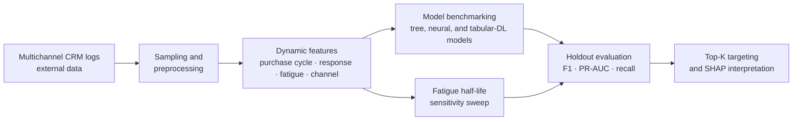

# Purchase Conversion Prediction with Dynamic CRM Features

[한국어](README.ko.md) · [Case study](PORTFOLIO.md)

Predicts which recipients of e-commerce CRM messages will make a purchase,
using features built from marketing theory (purchase cycle, response timing,
message fatigue, channel fit) on about 172 million REES46 messaging logs, where
only 0.1234% of holdout rows convert.

**Why it matters.** Sending every campaign to everyone costs money and wears
customers out, so the useful output is a ranking of who is worth contacting.
At this conversion rate accuracy is meaningless; the question is how many
buyers a model finds and how many messages it wastes doing so.

**Result (manuscript-reported).** On the original-distribution holdout, adding
the domain features to XGBoost raised F1 from 0.3550 to 0.3806 and PR-AUC from
0.3177 to 0.3620. Recall rose from 30.74% to 52.30% while precision fell from
0.4199 to 0.2991, so the model finds more buyers at the cost of more wasted
contacts. Selecting the top 0.78% of scores captured 95.83% of holdout
conversions: an offline ranking result, not realised savings or causal uplift.

The manuscript is under peer review and not included; the raw logs are not
redistributed. A smaller XGBoost run retained in this repository can be checked
without data (see [How to run](#how-to-run)).

## Research question

Can dynamic domain-knowledge features improve purchase conversion prediction
and marketing targeting decisions when the positive conversion class is rare?

The research operationalizes four feature groups:

1. Purchase and repurchase-cycle patterns
2. Temporal response patterns
3. Marketing-fatigue patterns
4. Marketing-channel effectiveness patterns

## Dataset and evaluation

- **Source data:** Kaggle REES46 *E-commerce multichannel direct messaging
  2021–2023*, about two years of logs
- **Scale (manuscript):** approximately 172 million messaging events, about
  1.85 million customers, 1,907 campaigns
- **Target:** purchase conversion
- **Holdout conversion rate:** 0.1234%
- **Models compared:** 9 ML, neural-network, and tabular-DL models
- **Evaluation:** original-distribution holdout set, including F1, PR-AUC,
  recall, and targeting analyses

## Analysis flow



The raw CRM logs are not included in this repository. The executable pipeline
and compact result reports provide the implementation and evidence trail for
the flow above.

## Key results

Manuscript-reported XGBoost results on the original-distribution holdout:

| Measure | Baseline features | Domain-enhanced features |
|---|---:|---:|
| Precision | 0.4199 | 0.2991 |
| Recall | 30.74% | 52.30% |
| F1 score | 0.3550 | 0.3806 |
| F2 score | 0.3248 | 0.4549 |
| PR-AUC | 0.3177 | 0.3620 |

- Relative recall improvement: 70.1%.
- Targeting at the top 0.78% of scores: 95.83% of conversions captured, with
  99.22% fewer selected messages than contacting every candidate.

Retained in this repository (a separate, smaller run on
`final_data_100k_64.parquet`, 64 features, 1,499,900-row holdout):

| Measure | Domain-enhanced XGBoost |
|---|---:|
| F1 score | 0.3833 |
| PR-AUC | 0.3534 |
| Source | `research/predict/result_xgb.json` |

The two result sets come from different data scales and splits and are not
combined. Across fatigue half-life multipliers from 0.50x to 1.50x, the
retained sweep keeps PR-AUC between 0.3527 and 0.3613
(`research/predict/tau_sweep_results/`).

## What the results do and do not mean

- They are study-specific evidence from one platform's observational data and
  a random holdout, not a general causal estimate.
- The top-K figures are a simulated ranking on the holdout. There is no live
  send record, unit cost, or control group, so they are not realised savings or
  incremental conversions.
- Precision fell while recall rose; choosing an operating point would need the
  cost of a contact and of a missed buyer, which are not available.
- The study lists single-platform generalization, fixed fatigue half-life
  parameters, the lack of causal inference, and unmeasured compute efficiency
  as limitations.
- SHAP results are associations, not evidence of causal uplift.

## Research figures


*Figure 1. The research workflow: four CRM input tables, baseline and four
domain-feature groups, nine models, and the manuscript's evaluation panels
(model comparison, feature-group ablation, top-K targeting, half-life
sensitivity, SHAP). The result values in the panels are the manuscript-reported
values in the tables above.*


*Figure 2. Features ranked by positive and negative SHAP contribution, coloured
by the knowledge category they belong to (baseline, fatigue, temporal response,
channel effectiveness, purchase cycle).*


*Figure 3. SHAP values summarize the direction and relative contribution of the
features in the documented model run. They are associational, not evidence of
causal uplift.*

## How to run

An end-to-end run is not possible from this checkout: the source data, fitted
models, dependency lockfile, and original environment are not included.

Check the retained result without data (standard library only):

```powershell
python research\verify_baseline.py
```

It confirms that `research/predict/result_xgb.json` matches the saved metric
contract (F1, PR-AUC, recall, precision, top-K hits). It is a report-regression
check, not a model rerun.

With the original Parquet file, set paths explicitly and rerun XGBoost:

```powershell
pip install -r requirements.txt
$env:MFA_DATASET_PATH = 'D:\path\to\final_data_100k_64.parquet'
$env:MFA_RESULTS_DIR = 'D:\path\to\new-results'
python research\xgb.py
python research\verify_baseline.py --result "$env:MFA_RESULTS_DIR\result_xgb.json"
```

Other entry points are `research/preprocessing_fast.py` (feature engineering)
and `research/run_xgb_tau_sweep.py` (half-life sweep). `requirements.txt` lists
packages derived from the imports; the original versions were not recorded, so
an exact numerical match is not guaranteed. Details are in
[research/RUN_MANIFEST.md](research/RUN_MANIFEST.md).

## Repository layout

```text
.
├── research/                         # Integrated executable research work
│   ├── preprocessing_fast.py          # Feature engineering pipeline
│   ├── xgb.py, RF.py, MLP.py          # Tabular-model experiments
│   ├── CNN.py, RNN.py, LSTM.py        # Neural baselines
│   ├── CNNLSTM.py, RNNLSTM.py, tabnet.py
│   ├── run_xgb_tau_sweep.py           # Fatigue half-life sensitivity sweep
│   ├── verify_baseline.py             # Report-regression check
│   └── predict/                       # Compact JSON/CSV experiment outputs
├── images/paper/                      # Research figures
└── references/                        # Prior-literature notes
```

## Documentation

- [Portfolio case study](PORTFOLIO.md)
- [Repository review](docs/PROJECT_REVIEW.md)
- [Academic summary](docs/ACADEMIC_SUMMARY.md)
- [CV bullets](docs/CV_BULLETS.md)
- [Run manifest](research/RUN_MANIFEST.md)
- Prior-literature notes: `references/legacy-prior-research/`
