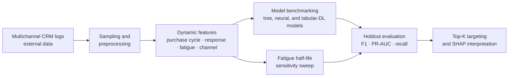

# Purchase Conversion Prediction with Dynamic CRM Features

[한국어](README.ko.md) · [Case study](PORTFOLIO.md)

*A Data-Centric AI Framework for E-Commerce Purchase Conversion Prediction via Dynamic Marketing Knowledge Integration*: first-author paper (with Kyung-won Kim, corresponding), forthcoming in *마케팅연구* (Korean Marketing Association), November 2026.

Predicts which recipients of e-commerce CRM messages will buy, using features
built from marketing theory (purchase cycle, response timing, message fatigue,
channel fit) on about 172 million REES46 messaging logs, where 0.1234% of
holdout rows convert.

**Why it matters.** At this conversion rate accuracy is meaningless. What
matters is how many buyers a ranking finds and how many messages it wastes.

**Result (manuscript, original-distribution holdout).** Domain features raised
XGBoost PR-AUC from 0.3177 to 0.3620 and recall from 0.3074 to 0.5230; precision
fell from 0.4199 to 0.2991. Contacting only the top 0.78% of scores captured
95.83% of conversions at a precision of 15.26%, a lift of 123.7x over random
sending; the top 10,000 messages reached 53.20% precision (431.1x).

## Research question

Can dynamic domain-knowledge features improve conversion prediction and
targeting when the positive class is rare? Four feature groups:

1. Purchase and repurchase cycle
2. Temporal response
3. Marketing fatigue (channel-specific decayed sums, 24/48/72-hour half-lives)
4. Channel effectiveness

## Data and evaluation

- **Source:** Kaggle REES46 *E-commerce multichannel direct messaging
  2021–2023*: about 172 million messages, 1.85 million customers, 1,907
  campaigns (manuscript figures)
- **Target:** purchase conversion; holdout conversion rate 0.1234%
- **Models:** 9 tree, neural, and tabular-DL models
- **Evaluation:** original-distribution holdout; F1, PR-AUC, recall, top-K
  targeting



## Results

Manuscript-reported XGBoost, original-distribution holdout:

| Measure | Baseline features | Domain-enhanced features |
|---|---:|---:|
| Precision | 0.4199 | 0.2991 |
| Recall | 0.3074 | 0.5230 |
| F1 | 0.3550 | 0.3806 |
| F2 | 0.3248 | 0.4549 |
| PR-AUC | 0.3177 | 0.3620 |

**Top-K targeting (manuscript, 25,798,280-message test set):**

| Top K | Share | Precision@K | Recall | Lift |
|---|---:|---:|---:|---:|
| 10,000 | 0.04% | 53.20% | 16.71% | 431.1x |
| 50,000 | 0.19% | 31.16% | 48.94% | 252.5x |
| 200,000 | 0.78% | 15.26% | 95.83% | 123.7x |

**Run retained in this repository** (smaller sample, `final_data_100k_64.parquet`,
64 features, 1,499,900-row holdout; `research/predict/result_xgb.json`):
F1 0.3833, PR-AUC 0.3534. It uses a different scale and split from the
manuscript, so the two sets are reported separately. Across fatigue half-life
multipliers 0.50x–1.50x, PR-AUC stays between 0.3527 and 0.3613
(`research/predict/tau_sweep_results/`).

## Figures


*Figure 1. Workflow: four CRM tables, baseline and four domain-feature groups,
nine models, and the manuscript's evaluation panels.*


*Figure 2. Features ranked by SHAP contribution, coloured by knowledge category.*


*Figure 3. Direction and relative size of feature contributions in the
documented run.*

## How to run

Check the retained result without data (standard library only):

```powershell
python research\verify_baseline.py
```

With the original Parquet file:

```powershell
pip install -r requirements.txt
$env:MFA_DATASET_PATH = 'D:\path\to\final_data_100k_64.parquet'
$env:MFA_RESULTS_DIR = 'D:\path\to\new-results'
python research\xgb.py
python research\verify_baseline.py --result "$env:MFA_RESULTS_DIR\result_xgb.json"
```

Other entry points: `research/preprocessing_fast.py` (features),
`research/run_xgb_tau_sweep.py` (half-life sweep). See
[research/RUN_MANIFEST.md](research/RUN_MANIFEST.md).

## Limitations

- Manuscript text not included before publication; raw logs not redistributed.
- Package versions of the original runs were not recorded; exact numerical
  reproduction is not guaranteed.
- Random holdout on one platform's observational data; no causal estimate.
- Top-K figures are an offline ranking on the holdout, not realised savings or
  incremental conversions.
- An operating point needs contact and missed-buyer costs, which are not
  available.
- SHAP shows associations, not causal effects.

## Repository layout

```text
.
├── research/                         # Executable research code
│   ├── preprocessing_fast.py          # Feature engineering pipeline
│   ├── xgb.py, RF.py, MLP.py          # Tabular-model experiments
│   ├── CNN.py, RNN.py, LSTM.py        # Neural baselines
│   ├── CNNLSTM.py, RNNLSTM.py, tabnet.py
│   ├── run_xgb_tau_sweep.py           # Fatigue half-life sensitivity sweep
│   ├── verify_baseline.py             # Report-regression check
│   └── predict/                       # Compact experiment outputs
├── images/paper/                      # Research figures
└── references/                        # Prior-literature notes
```

[Case study](PORTFOLIO.md) · [Repository review](docs/PROJECT_REVIEW.md) ·
[Academic summary](docs/ACADEMIC_SUMMARY.md) · [CV bullets](docs/CV_BULLETS.md)
